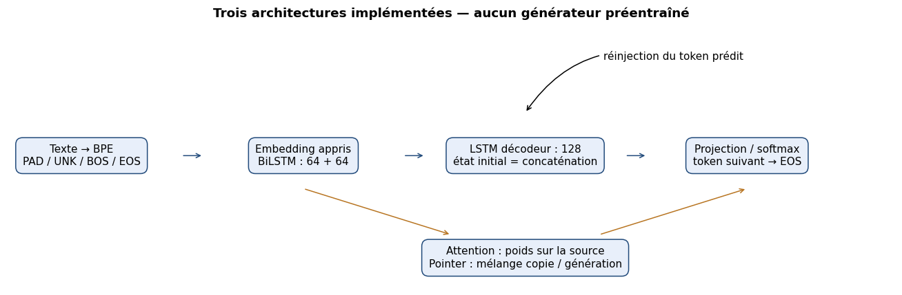
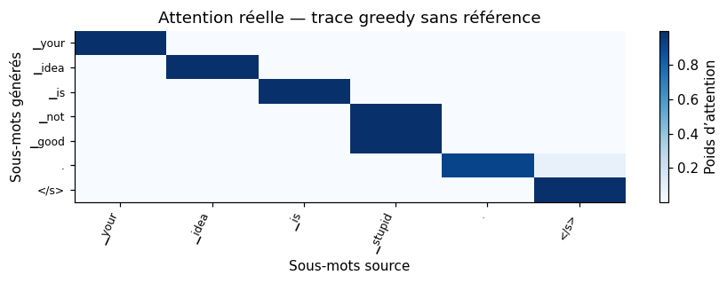
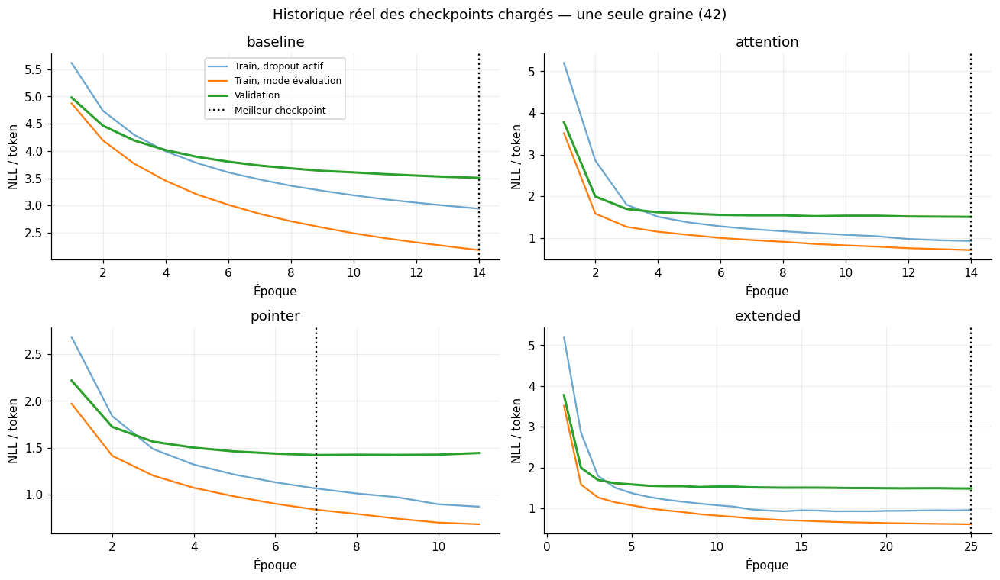
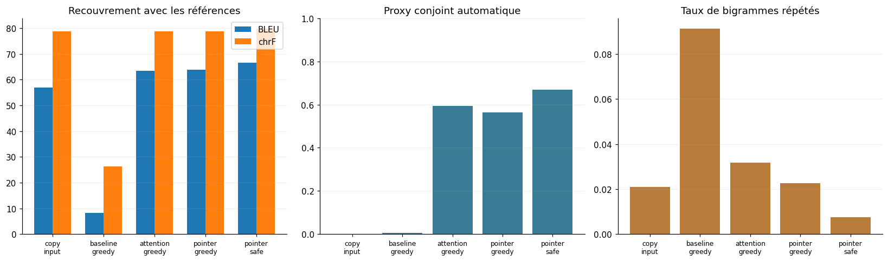
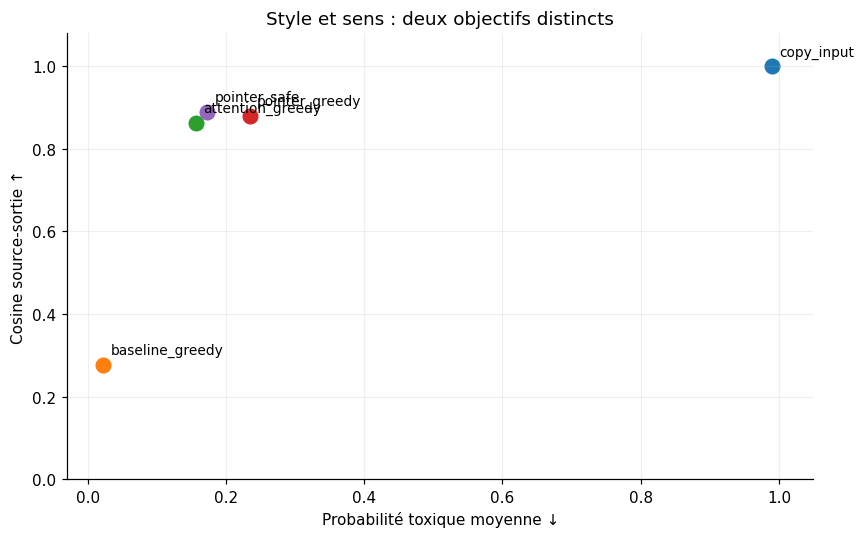

<div align="center">

  <sub>DEEP LEARNING  ·  NATURAL LANGUAGE PROCESSING  ·  SEQUENCE-TO-SEQUENCE</sub>

  <h1>ParaDetox</h1>

  <h3>Neural Text Detoxification with Encoder–Decoder Models</h3>

  <p><strong>Change the tone. Preserve the meaning.</strong></p>

  <p>
    An end-to-end research project exploring how recurrent neural networks can rewrite offensive language
    without losing the message — built, trained, compared and critically evaluated in PyTorch.
  </p>

  <p>
    
    
    
    
    
  </p>

  <p>
    <a href="#project-at-a-glance">Results</a> &nbsp;·&nbsp;
    <a href="#the-research-question">Research question</a> &nbsp;·&nbsp;
    <a href="#architectures">Architectures</a> &nbsp;·&nbsp;
    <a href="#experiments-and-findings">Experiments</a> &nbsp;·&nbsp;
    <a href="#reproduce-the-experiment">Reproduce</a> &nbsp;·&nbsp;
    <a href="#documentation-and-repository-map">Documentation</a>
  </p>

</div>

---

## Project at a glance

> **Can we remove toxicity without removing meaning?**  
> This project treats text detoxification as **conditional text generation**, not simply toxicity detection or word deletion.

<table>
  <tr>
    <td align="center" width="25%"><strong>19,003</strong><br/><sub>Cleaned parallel pairs</sub></td>
    <td align="center" width="25%"><strong>3</strong><br/><sub>Architectures from scratch</sub></td>
    <td align="center" width="25%"><strong>66.59</strong><br/><sub>Best test BLEU ↑</sub></td>
    <td align="center" width="25%"><strong>79.88</strong><br/><sub>Best test chrF ↑</sub></td>
  </tr>
</table>

**Selected system:** `BiLSTM + Attention + Pointer` with **Safe Decoding**.

**66.81% joint automatic proxy** on **1,193 distinct held-out test inputs**. This is a multi-criterion *automatic* indicator — **not** human-judged grammatical accuracy or a guarantee of correct paraphrases.

<table>
<tr>
<td width="50%" valign="top">

**The work**
- A full supervised NLP pipeline, from raw data to evaluation.
- Three custom-built generative architectures.
- Greedy decoding, beam search and candidate reranking.
- Quantitative comparison **and** real error analysis.

</td>
<td width="50%" valign="top">

**The key finding**
- Attention is essential for the small recurrent models studied here.
- Copying can help preserve information, **but may also retain toxicity**.
- Decoding choices change the final quality trade-off.
- Lower toxicity alone does **not** mean a good paraphrase.

</td>
</tr>
</table>

<p align="center">
  <a href="notebooks/ParaDetox.ipynb"><strong>Explore the executed notebook</strong></a>
  &nbsp;·&nbsp;
  <a href="docs/Technical_Report.pdf"><strong>Read the technical report</strong></a>
  &nbsp;·&nbsp;
  <a href="docs/Presentation.pdf"><strong>View the presentation</strong></a>
</p>

---

## The research question

### Text detoxification is more than offensive-word removal

Given a potentially toxic source sentence `x`, the model must produce a neutral paraphrase `y` while optimizing **three competing objectives**:

| Objective | What it means | Example of failure |
|:--|:--|:--|
| **Style transfer** | Reduce aggressive, insulting or offensive wording | Toxic terms remain in the output |
| **Semantic fidelity** | Retain the speaker's intent, facts, names, numbers and negations | Meaning is reversed or details disappear |
| **Linguistic fluency** | Generate complete, coherent and grammatical text | Deleting an insult breaks the sentence |

**Observed success**

```
Input   "Your idea is stupid."
Output  "Your idea is bad."
~~~`

The evaluation is intentionally more demanding than classifying a sentence as toxic / non-toxic: the system must **generate** a usable alternative.

Formally, the models approximate the conditional distribution

$$
P_\theta(y\mid x) = \prod_{t=1}^{m} P_\theta(y_t\mid y_{<t}, x)
$$

where each target subword is predicted using the source and previously generated target tokens.

---

## End-to-end pipeline

<p align="center">
  
</p>
<p align="center"><sub>Figure — Model pipeline exported from the executed experiment notebook.</sub></p>

```text
ParaDetox parallel corpus
          │
          ▼
Cleaning & grouped train / validation / test split
          │
          ▼
SentencePiece BPE · 2,000 subwords
          │
          ▼
Trainable embeddings · 96 dimensions
          │
          ▼
BiLSTM encoder → LSTM decoder
          │              ├─ baseline
          │              ├─ attention
          │              └─ attention + pointer
          ▼
Supervised token-level training
          │
          ▼
Greedy / Beam / Safe reranking
          │
          ▼
Held-out evaluation + qualitative diagnostics
~~~`

The **generative networks are initialized randomly and trained from scratch**. Pretrained RoBERTa / sentence-embedding models are used **only as evaluation instruments**, never to generate or rewrite sentences.

---

## Dataset and preprocessing

**Source:** [ParaDetox — s-nlp/paradetox](https://huggingface.co/datasets/s-nlp/paradetox), pinned dataset revision `958b799`.

The corpus pairs English toxic comments (`en_toxic_comment`) with neutral rewrites (`en_neutral_comment`). Multiple acceptable neutral targets may exist for a single source.

### Dataset composition

| Partition | Pairs | Distinct normalized sources |
|:--|--:|--:|
| Raw corpus | 19,744 | — |
| After cleaning and deduplication | **19,003** | — |
| Training, before augmentation | 15,201 | 9,541 |
| Validation | 1,901 | 1,193 |
| Test | 1,901 | **1,193** |
| Effective training after augmentation | **16,823** | Includes resampling |

**Leakage prevention:** connected pairs with identical normalized sources or targets are assigned to the same split. An exact-overlap check is performed after grouping. This does **not** eliminate the possibility of semantically near-identical phrases across splits.

### Input representation

- **Normalization:** Unicode NFKC, consolidated whitespace and lowercase text; punctuation and negations are retained.
- **Tokenizer:** SentencePiece BPE trained exclusively on the **original training split**.
- **Vocabulary:** 2,000 subword units.
- **Special tokens:** `PAD = 0`, `UNK = 1`, `BOS = 2`, `EOS = 3`.
- **Embedding layer:** 96-dimensional trainable embeddings.
- **Train-only augmentation:** 1,216 neutral→neutral identity pairs and 406 targeted resampled examples (including number- and negation-related cases).

All validation and test data remain unaugmented. The dataset is **downloaded during execution**, not redistributed in this repository.

**More:** [Dataset and preprocessing notes](docs/DATASET.md).

---

## Architectures

Three encoder–decoder designs were independently trained under the initial shared experimental budget.

| Model | Trainable parameters | Mechanism | Main question |
|:--|--:|:--|:--|
| **A · BiLSTM Seq2Seq** | 949,712 | Final encoder state → LSTM decoder | Can a recurrent baseline learn the rewriting task? |
| **B · BiLSTM + Attention** | 1,370,576 | Decoder attends to source positions at each step | Does dynamic source access improve content preservation? |
| **C · BiLSTM + Attention + Pointer** | 1,371,057 | Vocabulary generation + source-subword copying | Can explicit copying preserve useful information? |

### A — BiLSTM Encoder–Decoder

The one-layer **bidirectional LSTM encoder** processes each source sentence in both directions (96 hidden units per direction). Its concatenated 192-dimensional final state initializes a one-layer 192-dimensional **LSTM decoder**, which predicts the next token autoregressively.

**Bottleneck:** the baseline depends strongly on a fixed final representation; this can lose important context.

### B — Attention-augmented Seq2Seq

At each generation step, the decoder scores encoder hidden states, masks padded source positions, and computes a weighted context vector:

$$
\alpha_{t,i} = \operatorname{softmax}_i(e_{t,i}),
\qquad
z_t = \sum_i \alpha_{t,i}h_i
$$

The model can consult different parts of the input as the output unfolds, rather than relying only on a final encoder state.

### C — Pointer-generator

The pointer mechanism learns a generation / copy gate and combines two token distributions:

$$
P(w\mid t) =
g_t P_{\mathrm{vocab}}(w\mid t)
+ (1-g_t)\sum_{i:x_i=w}\alpha_{t,i}
$$

Repeated source subwords are aggregated using `scatter_add`. The mechanism is useful for retaining source details, but **copying offensive words is an inherent risk**.

<details>
<summary><strong>Attention visualization from the notebook</strong></summary>
<br/>
<p align="center"></p>
</details>

**More:** [Architecture details](docs/MODELS.md).

---

## Training procedure

Each system is trained on aligned toxic / neutral pairs using **token-level negative log-likelihood (NLL)**, excluding padding tokens.

| Setting | Recorded value | Setting | Recorded value |
|:--|:--|:--|:--|
| Optimizer | AdamW | Initial learning rate | 0.002 |
| Batch size | 64 | Weight decay | 1e-4 |
| Embeddings | 96 | Decoder hidden size | 192 |
| LSTM layers | 1 | Dropout | 0.25 |
| Gradient clipping | 1.0 | Seed | 42 |
| Initial training budget | Up to 14 epochs | Early stopping | Patience 4 |
| LR scheduler | ReduceLROnPlateau | Checkpoint choice | Lowest validation NLL |

**Teacher forcing** initially feeds the previous ground-truth target token to the decoder. During inference, the model instead consumes its own previous prediction: this difference is a source of *exposure bias*.

An additional **extended Attention** run was trained up to 25 epochs with an exploratory teacher-forcing schedule (potentially 1.0 → 0.85 after epoch 12). Because duration and schedule change together, that experiment **does not independently isolate** the impact of scheduled sampling.

**Observed selected checkpoints:** baseline epoch 14, Attention epoch 14, Pointer epoch 7.

<p align="center">
  
</p>
<p align="center"><sub>Figure — Recorded token-level NLL curves; vertical markers identify selected validation checkpoints.</sub></p>

**More:** [Training methodology](docs/TRAINING.md).

---

## Inference and system selection

A trained model does not define a complete generation system on its own. This project compares decoding strategies:

| Strategy | Mechanism | Trade-off |
|:--|:--|:--|
| **Greedy** | Selects the most probable token at each step | Fast, may commit to poor local choices |
| **Beam search** | Maintains several partial sequences with length normalization | Explores alternatives, still follows model probabilities |
| **Safe Decoding** | Heuristically reranks model-generated candidates | Favors completeness, plausible phrasing and selected factual preservation checks |

Additional candidate constraints target repeated trigrams. Generation starts with `BOS` and terminates at `EOS` or a maximum of **64 output tokens**.

The chosen system was selected using **validation only**: initially 250 distinct sources, then the complete 1,193-source validation set. Final metrics were evaluated on the distinct 1,193-source **held-out test set**.

Safe Decoding is **not** a learned grammar correction model and does not guarantee a valid sentence.

**More:** [Decoding and selection protocol](docs/INFERENCE.md).

---

## Experiments and findings

### Quantitative comparison — held-out test

| System | BLEU ↑ | chrF ↑ | Toxicity ↓ | Semantic cosine ↑ | Joint proxy ↑ |
|:--|--:|--:|--:|--:|--:|
| Copy original input | 56.86 | 78.69 | 0.990 | 1.000 | 0.08% |
| BiLSTM baseline · Greedy | 8.31 | 26.20 | 0.022 | 0.277 | 0.59% |
| BiLSTM + Attention · Greedy | 63.44 | 78.76 | 0.156 | 0.862 | 59.35% |
| BiLSTM + Pointer · Greedy | 63.81 | 78.69 | 0.234 | 0.879 | 56.50% |
| **Pointer + Safe Decoding** | **66.59** | **79.88** | **0.173** | **0.890** | **66.81%** |

<p align="center">
  
</p>
<p align="center"><sub>Figure — Original comparative evaluation figure from the executed notebook.</sub></p>

### What the metrics mean

- **BLEU / chrF:** lexical and character overlap with neutral references; valid alternative paraphrases may score differently.
- **Predicted toxicity:** a public RoBERTa classifier's toxic-class estimate, **not** human annotation.
- **Semantic cosine:** similarity between source and output embeddings from `all-MiniLM-L6-v2`; high similarity can still miss contradictions.
- **Joint proxy:** a rule-based combination of toxicity, semantic similarity, nonempty / untruncated output, repetition and selected content-preservation checks.

**Most important:** **66.81% is not a grammar accuracy score, not a human evaluation, and not proof that 66.81% of generations are flawless.**

### Interpreting the trade-offs

1. **The baseline collapses in content quality.** It produces low predicted toxicity but poor BLEU and low semantic similarity. Avoiding toxic words alone is not enough.
2. **Attention is the largest architectural improvement.** BLEU rises from **8.31** (baseline greedy) to **63.44** (Attention greedy) under the comparable initial setup.
3. **Pointer is not automatically safer.** Pointer greedy reaches higher semantic similarity than Attention greedy but also higher predicted toxicity.
4. **Reranking matters.** Pointer + Safe reaches **66.59 BLEU** and **66.81% joint proxy**, improving the proxy over Attention greedy by **7.46 percentage points** in this evaluation.

<p align="center">
  
</p>
<p align="center"><sub>Figure — Additional model diagnostics exported from the notebook.</sub></p>

**More:** [Evaluation definitions and complete results](docs/EVALUATION.md).

---

## Qualitative evaluation: the outputs that matter

Automatic scores tell only part of the story. The following are **actual recorded model outputs**, not manually polished paraphrases.

### Examples of successful local rewriting

| Toxic input | Model output | Interpretation |
|:--|:--|:--|
| "Your idea is stupid." | **"Your idea is bad."** | Softens a direct insult while retaining criticism |
| "This explanation is garbage." | **"This explanation is bad."** | Replaces offensive evaluation |
| "This damn computer keeps crashing." | **"This computer keeps crashing."** | Removes expletive while preserving the complaint |
| "What the hell are you doing?" | **"What are you doing?"** | Removes an aggressive expression |

### Failure analysis — without hiding mistakes

| Toxic input | Observed model output | What failed |
|:--|:--|:--|
| "Stop acting like an idiot." | **"Stop acting like an."** | Incomplete sentence |
| "What a dumb decision!" | **"What an decision!"** | Incorrect article / grammar |
| "These idiots ruined the meeting." | **"These ruin ruined the meeting."** | Duplicated or malformed wording |
| "She worked her ass off to prepare the presentation." | **"She worked her off to prepare the presentation."** | Broken idiomatic expression |
| "The stupid report says 18.5% instead of 15.8%." | **"The stupid report says 18.5% instead of 15."** | Residual toxicity **and** truncated numerical fact |

The main failure mode is **overly local editing**: removing a toxic subword can break syntax, change the intended meaning or corrupt a number. A stronger system must learn **phrase-level reformulation**, not only substitutions.

These examples come from *selected diagnostic prompts* (60 initial + 40 additional checks). They are **not** a representative sample for estimating a population-wide grammatical success rate.

**More:** [Full qualitative and error analysis](docs/ERROR_ANALYSIS.md).

---

## Limitations and next steps

<table>
<tr>
<td width="50%" valign="top">

**Current limitations**

- Moderate corpus size and 2,000-subword vocabulary.
- Only **one training seed** in the reported comparison.
- Weaknesses on idioms, grammar, negations, dates and decimals.
- Automatic toxicity and similarity models can miss meaningful errors.
- No full independent blind human evaluation.
- Extended Attention varies more than one experimental factor.

</td>
<td width="50%" valign="top">

**Research directions**

- Repeat training across several seeds and report uncertainty.
- Add independent human ratings for style, fidelity and fluency.
- Improve idiom-aware and phrase-level transformations.
- Strengthen number, named-entity and negation consistency checks.
- Assess robustness on new domains and difficult test sets.
- Explore coverage or better-grounded factual constraints.

</td>
</tr>
</table>

These are **proposed improvements**, not features already implemented or experimentally validated.

---

## Reproduce the experiment

### 1 — Clone and install

```bash
git clone https://github.com/SoumayaRomdhani/NLP--ParaDetox-Encoder-Decoder.git
cd NLP--ParaDetox-Encoder-Decoder

python -m pip install -r requirements.txt
~~~`

### 2 — Open the research notebook

**Recommended:** Google Colab with a GPU-enabled runtime (original experiment: NVIDIA Tesla T4).

[](https://colab.research.google.com/github/SoumayaRomdhani/NLP--ParaDetox-Encoder-Decoder/blob/main/notebooks/ParaDetox.ipynb)

Run the notebook in its documented order. It fetches the pinned dataset, checks its SHA-256 integrity, prepares the data, trains the models, performs validation selection and generates test metrics / diagnostic examples.

### 3 — Reproducibility boundaries

- **Recorded environment:** Google Colab, Python 3.13.16, PyTorch 2.11.0+cu130, NVIDIA Tesla T4, seed 42.
- **Checkpoints not included:** rerunning means **retraining**, potentially with substantial GPU time.
- **Network required:** dataset and pretrained *evaluation-only* models are downloaded.
- **Exact bitwise reproducibility is not guaranteed:** GPU operations, dependency versions and runtime differences may change results.
- **Implementation location:** the executed notebook is the **single canonical source**. This repository does not claim a standalone Python package, trained model download or public inference API.

For details, see [`docs/REPRODUCIBILITY.md`](docs/REPRODUCIBILITY.md).

---

## Documentation and repository map

```text
NLP--ParaDetox-Encoder-Decoder/
├── README.md
├── requirements.txt
├── .gitignore
├── CITATION.cff
├── CONTRIBUTING.md
│
├── notebooks/
│   └── ParaDetox.ipynb           # Executed end-to-end research notebook
│
├── assets/
│   ├── architecture.png         # Source-to-output system overview
│   ├── learning_curves.png      # Recorded train/validation NLL
│   ├── model_comparison.png     # BLEU / chrF / model comparison
│   ├── model_diagnostics.png    # Complementary diagnostics
│   └── attention_heatmap.png    # Attention visualization
│
└── docs/
    ├── DATASET.md               # Source, splits, tokenization
    ├── MODELS.md                # Architecture and pointer mechanism
    ├── TRAINING.md              # Loss, checkpoints, hyperparameters
    ├── INFERENCE.md             # Greedy, beam and safe reranking
    ├── EVALUATION.md            # Metrics and test comparisons
    ├── ERROR_ANALYSIS.md        # Real generations and limitations
    ├── REPRODUCIBILITY.md       # Environment and rerun guidance
    ├── Technical_Report.pdf     # Academic technical report (FR)
    └── Presentation.pdf         # Final presentation (FR)
~~~`

| Start here | Read this for… |
|:--|:--|
| [`notebooks/ParaDetox.ipynb`](notebooks/ParaDetox.ipynb) | Source implementation and recorded outputs |
| [`docs/DATASET.md`](docs/DATASET.md) | Cleaning, leakage-aware splits and tokenizer |
| [`docs/MODELS.md`](docs/MODELS.md) | Neural architecture and pointer distribution |
| [`docs/TRAINING.md`](docs/TRAINING.md) | Hyperparameters and convergence |
| [`docs/INFERENCE.md`](docs/INFERENCE.md) | Decoding strategies and selection |
| [`docs/EVALUATION.md`](docs/EVALUATION.md) | Quantitative evaluation and metric caveats |
| [`docs/ERROR_ANALYSIS.md`](docs/ERROR_ANALYSIS.md) | Representative successes and failures |
| [`docs/REPRODUCIBILITY.md`](docs/REPRODUCIBILITY.md) | Running the notebook responsibly |
| [Technical report](docs/Technical_Report.pdf) / [Slides](docs/Presentation.pdf) | Complete academic deliverables |

---

## References and attribution

**Dataset paper:** Logacheva et al. (2022), [*ParaDetox: Detoxification with Parallel Data*](https://aclanthology.org/2022.acl-long.469/), ACL 2022.

**Conceptual foundations:** Sutskever et al., *Sequence to Sequence Learning with Neural Networks* (2014); Bahdanau et al., *Neural Machine Translation by Jointly Learning to Align and Translate* (2015); See et al., *Get To The Point: Summarization with Pointer-Generator Networks* (2017). Full references appear in the technical report.

**Model implementations and experiments:** ROMDHANI Soumaya, M2 Artificial Intelligence & Data Science, **Université Paris Dauphine–PSL**, academic year 2026–2027.

The corpus and pretrained evaluation models belong to their respective authors and providers; this repository does not redistribute the original training dataset or trained evaluation-model weights. See [CITATION.cff](CITATION.cff) for project citation metadata.

---

<div align="center">
  <strong>From building models to understanding their failure modes.</strong>
  <br/>
  <sub>Research implementation · Comparative experiments · Transparent evaluation</sub>
</div>
