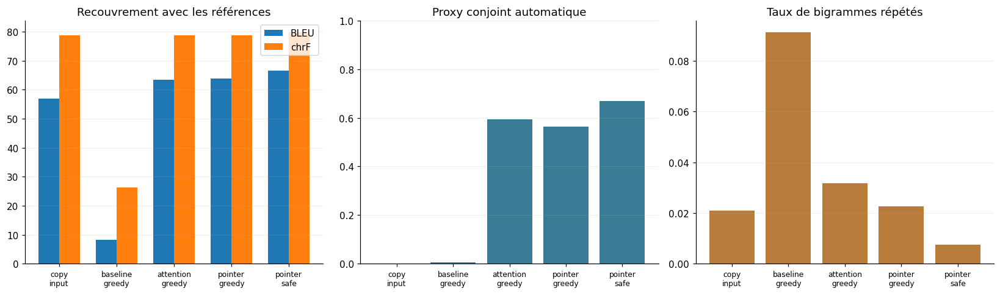
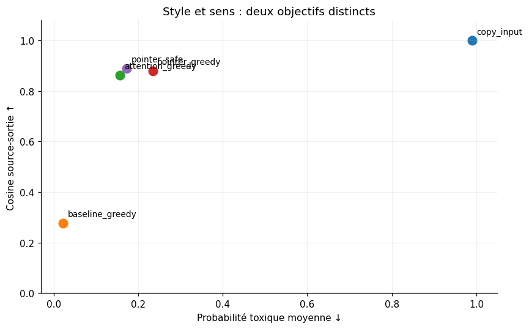

# Experimental evaluation

Held-out evaluation on **1,193 distinct source sentences** (1,901 paired test rows). Scores reflect the recorded executed notebook, seed 42.

| System | BLEU ↑ | chrF ↑ | Predicted toxicity ↓ | Semantic cosine ↑ | Joint proxy ↑ |
|---|---:|---:|---:|---:|---:|
| Copy input | 56.86 | 78.69 | 0.990 | 1.000 | 0.08% |
| BiLSTM baseline (greedy) | 8.31 | 26.20 | 0.022 | 0.277 | 0.59% |
| Attention (greedy) | 63.44 | 78.76 | 0.156 | 0.862 | 59.35% |
| Pointer (greedy) | 63.81 | 78.69 | 0.234 | 0.879 | 56.50% |
| **Pointer + Safe** | **66.59** | **79.88** | **0.173** | **0.890** | **66.81%** |

**BLEU / chrF:** lexical and character overlap with neutral references. **Toxicity:** predicted by `s-nlp/roberta_toxicity_classifier` (pretrained *evaluator*, not generator). **Semantic cosine:** source/generated embeddings via `sentence-transformers/all-MiniLM-L6-v2` (*evaluator*). **Joint proxy:** automatic threshold checks (toxicity < 0.5, cosine ≥ 0.8, nonempty and nontruncated output, repetition, length, names and number checks). **Not human-verified correctness.**

The selected system improves joint proxy over Attention greedy by approximately **7.46 percentage points**. The study has only one training seed and therefore does not measure across-run variance.

