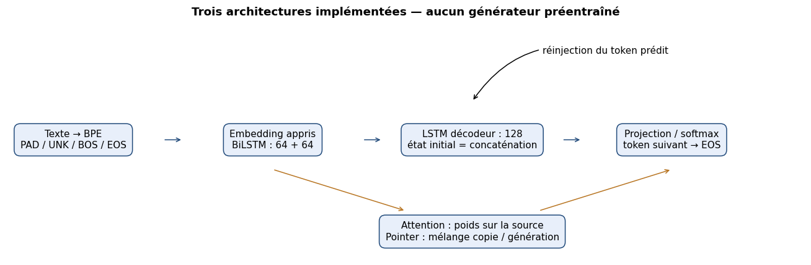

# Models implemented from scratch

1. **BiLSTM Encoder–Decoder (949,712 parameters):** one-layer bidirectional encoder with 96 units per direction; concatenated hidden size 192. One-layer decoder LSTM, hidden size 192, initialized from encoder final states. No dynamic source attention.
2. **BiLSTM + Attention (1,370,576 parameters):** decoder-query dot-product attention over masked encoder hidden states; next-token distribution uses both decoder state and source-context vector.
3. **BiLSTM + Attention + Pointer (1,371,057 parameters):** generation distribution mixed with source-subword copy distribution by a learned scalar gate `g_t`:

`p(w | t) = g_t p_vocab(w | t) + (1-g_t) Σ_{i:x_i=w} α_{t,i}`

The copy distribution is accumulated over identical subwords using `scatter_add`. This helps retain names and subwords but can also copy toxicity.

All generative weights are trained from scratch in PyTorch. An **extended Attention run** changes training budget/schedule; it is not a fourth independent architecture.

