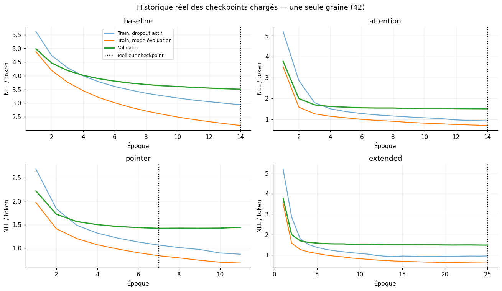

# Training methodology

**Objective:** minimize target-token negative log-likelihood, excluding `PAD`. The decoder uses 100% teacher forcing initially; during inference its previous predictions feed back into generation.

| Parameter | Value |
|---|---|
| Optimizer | AdamW |
| Initial learning rate | 0.002 |
| Weight decay | 1e-4 |
| Batch size | 64 |
| Embedding size | 96 |
| Decoder hidden size | 192 |
| LSTM layers | 1 |
| Dropout | 0.25 |
| Gradient clipping | 1.0 |
| Initial budget | max 14 epochs |
| Early stopping | patience 4; min delta 0.005 |
| Scheduler | ReduceLROnPlateau (factor 0.5, patience 1) |
| Random seed | 42 |
| Observed runtime | Google Colab NVIDIA Tesla T4 |

The best model checkpoint minimizes **validation NLL**. Observed retained epochs: baseline 14, Attention 14, Pointer 7.

**Exploratory extension:** attention continued up to 25 epochs with scheduled sampling after epoch 12 (teacher-forcing ratio potentially decreases from 1.0 to 0.85). Changes to duration and teacher forcing coincide, so their independent effects cannot be identified.

